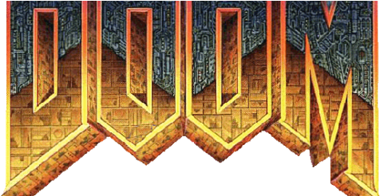
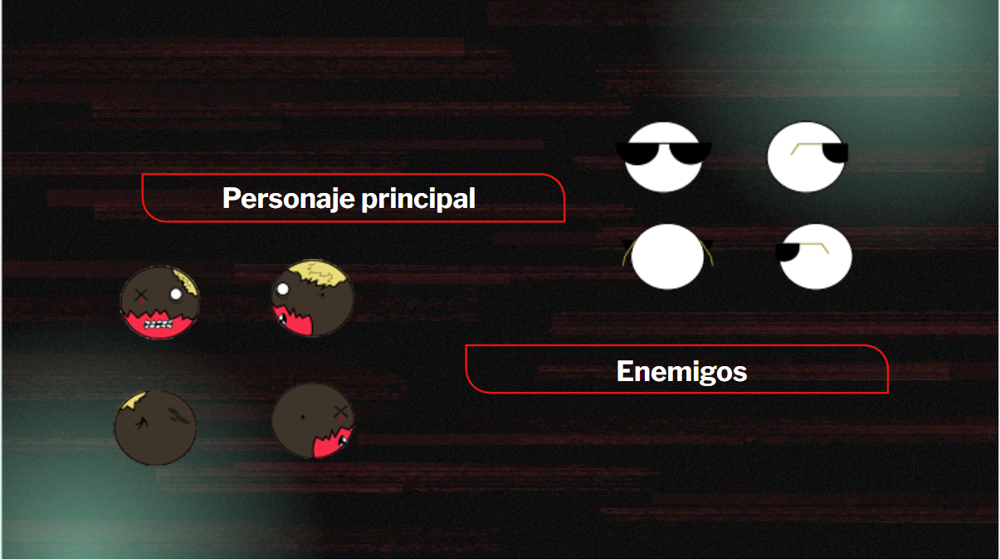
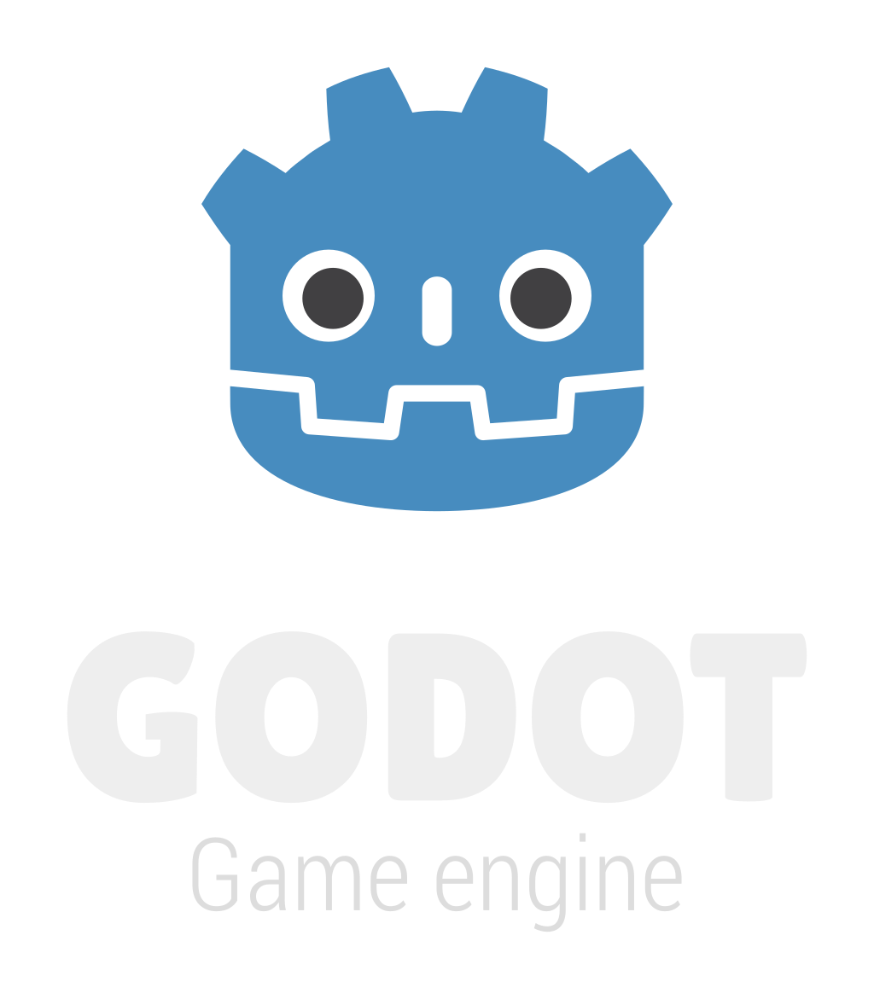
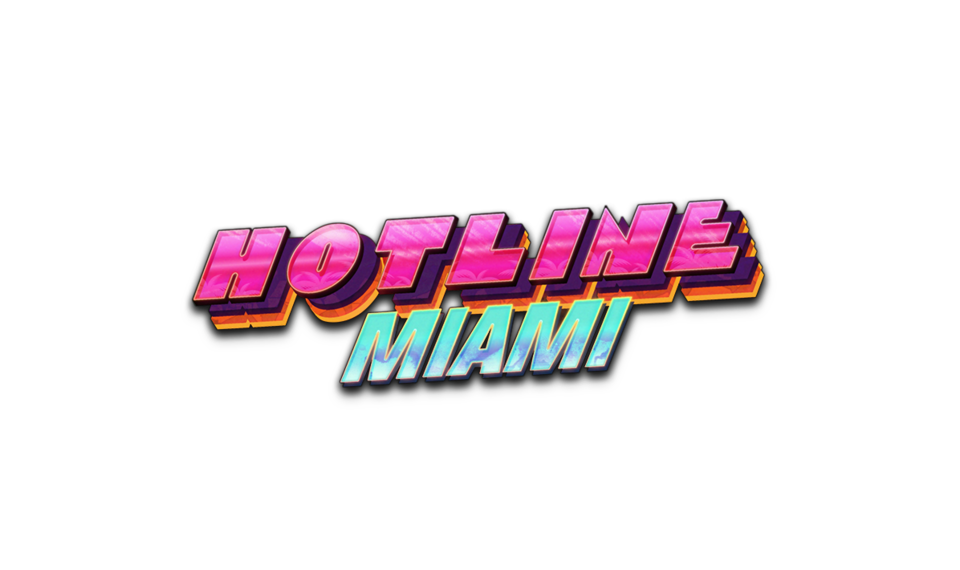
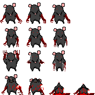
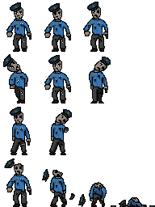
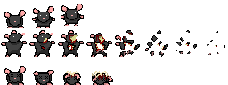

<h1 align = "center">Plague Exterminer</h1>

 
    $\color{red}{\text{SI ENCONTRASTE ESTE PROYECTO ESPERO QUE MI JUEGO TE HAYA GUSTADO}}$ 
    Se que esto parece un blog personal pero es el proceso completo de como desarrolle este juego

 

# Plague Exterminer (GAME DESIGN DOCUMENT)
Desarrollador único: Alonzo Estéfano Cuela Rodríguez (Dnur) 
## Idea del juego
Esta idea nacio para ser el primer videojuego de SkullStudios 
nació como idea de muchisimos prototipos lost media que hice antes, 
sin la más remota idea de que hacia, ahora tengo una idea más clara.   
<h1 align = "center">$\color{red}{\text{Hacer el juego más gore y visceral que se me haya ocurrido.}}$</h1> 
 

## Ideas pasadas
Jaja pues aqui te relatare el proceso de como nacio este proyecto,  
si quieres leer la documentacion de lo demás, puede saltarte esta parte 
es algo larga

LISTA DE INTENTOS PASADOS

1. UNSLAYED DEATH (la idea original): 
    

    Pues todo esto nace de la idea de programar juego, como cualquiera 
    que guste de este arte, tenia unos quince o dieciseis, cuando se me 
    ocurrio unir varias de mis franquicias favoritas, en ese momento de mi vida 
    juegos como: DOOM, Left 4 Dead 2, etc.  
    
      
    Queria hacer una especie de mundo abierto con zombies, un estilo de comic con 
    graficos como en DOOM, mas no tenia los conocimientos sobre programacion ni 
    idea de como empezar. 
    Puedes encontrar las viejas publicaciones en: <a href="https://www.instagram.com/skullstds/" style="color: #ff00d4; font-weight: bold;"> Mi Instagram</a> 
    

2. THERE'S NO TIME TO CRY (el aprendizaje): 
    

    Bueno, aunque en el texto plano parece que la idea anterior muto a el  
    juego presente, de hecho; esta idea surgio entre 2023 en adelante.  
    Si, UNSLAYED DEATH quedó cancelado, o bueno eso parecia, ya entrando 
    en la universidad, pues lleve un curso sobre desarrollo de videojuegos, 
    aunque era más publicidad que otra cosa, aprendí a programar de verdad y 
    más importante hice un prototipo que mis compañeros vieron, se llamaba 
    "THERE'S NO TIME TO CRY".  
    
    Debo admitir que el nombre suena como canción depresiva de los años 2000-2009 
    pero eran mis primeros esbozos en el mundillo del desarrollo.  
    El juego consistia en una bolita que se movia en un entorno TOP-DOWN (vista desde arriba) 
    tu misión era muy simple, unicamente tenias que recoger una llaves que estaban en las 4 esquinas 
    de la ventana, más los zombies aparecian en cualquier punto del mapa y te mataban al instante de 
    entrar en contacto con el jugador. 
    $\color{green}{\text{RECUERDO QUE LOS SPRITES DE LOS ZOMBIES TEMBLABAN AL COLISIONAR CON EL JUGADOR}}$ 
    

3. PLAGUE EXTERMINER PARTE 1 (el surgimiento e ideas viejas): 
    

    Esta es la etapa mas cercana a este documento, surgio cerca del 2024, cuando estabá muy frustrado 
    al no poder encontrar una idea para un juego y todas las que se me ocurrian pues las descartaba, culpando 
    a mi incapacidad y falta de talento, esas voces que muchas veces detienen a los grandes creadores de cumplir 
    sus metas, eran como una plaga que habitaba en mi cabeza, tomandolas como inspiracion decidi tomar las plagas 
    como tema para mi juego.  
    - El inicio del desarrollo: 
        

        Empece seleccionando el editor que me ayudaria en esta misión, lo que no sabia 
        es que ese era uno de los pasos mas dificiles cuando empiezas como desarrollador 
        surgen un montón de dudas, cosas como:
        - ¿Qué motor es mejor?
        - ¿Servirá para mi proyecto?
        Si, son dudas muy comunes pero la respuesta rápida es, UTILIZA CUALQUIER EDITOR. 
        Si aprendes a utilizarlo bien y lo entiendes, no hay limites para lo demás.
        

    - Una trama enredada: 
        

        Pues, pasando del problema que fue seleccionar el editor, termine optando por GODOT  
          
        De hecho ya lo conocia de un prototio anterior, aunque en su versión 3.X, actualmente utilizo 
        la 4.X, el nuevo problema (y futuro  $\color{red}{\text{ERROR}}$), fue empezar por buscar una trama 
        crear un protagonista (o intentarlo por lo menos), y empece armando un prototipo, al estilo de DOOM, 
        disponible en itch.io si deseas probarlo 
        <a href="https://skullstds.itch.io/plague-exterminer" style="color: #792d2dbe; font-weight: bold;"> PLAGUE EXTERMINER (OLD VERSIONS)</a> 
        la primera idea de trama era sobre un veterano de guerra, abandonado por la vida donde un personaje extraño (EL CONTRATADOR), lo convoca y lo  
        contrata como exterminador de plagas, sin embargo; la escena inicial se corrompio, eso me llevo a abandonar el proyecto unos meses.  
        Afortunadamente tambien estaba trabajando en la escena siguiente odne planeaba que al estilo de Hotline Miami  
          
        recibieras llamadas de desconocidos para empezar tus misiones. 
        Como puedes notar esa idea no prevalecio, de ella conserve ese segundo escenario que se convertiria en el principal 
        (UN HOTEL) donde la trama paso a que este veterano fue secuestrado por una empresa malévola, y el jugador se encontraba 
        en una trama donde estaba siendo entrenado para ser el villano, dandole un buen PLOT TWIST a la trama, 
        en ese proceso dibuje los sprites del primer enemigo una RATA MUTANTE.  
          
        Y esta trama tampoco se mantuvo, lo unico que cambió, fue que el protagonista ya no sería el veterano de guerra, 
        sino que seria un sicario, que habia ido a encargarse de un capo de la mafia, pero la plaga de ratas primigenia, coincidio 
        en su imvasión a la superficie.  
        En esta parte del desarrollo diseñe otras entidades que atacarian al jugador  
         
          
        Tuve otra idea donde la plaga era como un virus de computadora al estilo PONY ISLAND, vivias una aventura donde el juego estaba corrupto. 
        Y tal y como te imaginarás esa idea también quedo descartada, a este paso sabia que la trama se me escapaba de las manos y ue desviaba muchos 
        recursos del proyecto sin hacer avances reales, entre en la misma etapa de estancamineto que me haiba llevado a desarrollar este juego.  
        Salvo que algo cambio está vez, ahora no me sentia incapaz, sino que me importaba tanto elproyecto que olvide hacer las pruebas en Gray Box, 
        pruebas escenciales para saber que era lo que queria realmente del juego. 
        

    

4. PLAGUE EXTERMINER PARTE 2 (un reinicio forzosamente necesario): 
    

    
    
